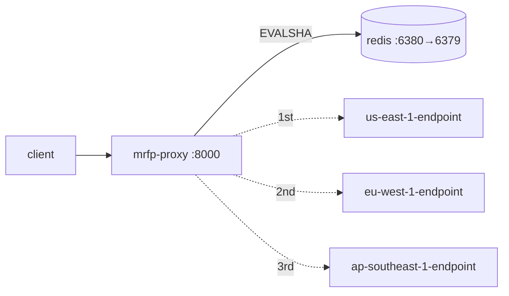

# CLAUDE.md

Agent-facing context for this repository. Read this before touching anything.

> Status: **complete.** All nine phases in §9 have landed and every scenario in the chaos matrix
> passes. The documentation set was authored before the application code, on purpose
> ([ADR-001](docs/DECISIONS.md#adr-001)) — so the contract in `docs/CONTRACT.md` predates and
> constrains the code, not the other way round.

---

## 1. What this is

A FastAPI reverse proxy in front of three containerised mock "cloud regions" that serve fake model
inference, plus a Redis token-bucket rate limiter and a chaos harness that kills a region mid-flood
and produces machine-generated evidence that traffic kept flowing.

The mock inference is not the point. The failure surface is: what `docker stop` actually does to an
HTTP client, what `docker pause` does differently, and why a Lua script is the only correct way to
decrement a shared counter.

---

## 2. Non-negotiable invariants

Breaking any of these breaks the project's stated requirements, not just its style.

| Invariant | Where it lives |
|---|---|
| Region containers are named **exactly** `us-east-1-endpoint`, `eu-west-1-endpoint`, `ap-southeast-1-endpoint`; a Redis container runs alongside | `docker-compose.yml` `container_name:` |
| Priority order is **us-east-1 → eu-west-1 → ap-southeast-1** | `config/regions.yaml`, `proxy/app/regions.py` |
| Read timeout is **200 ms**; every upstream call is inside `try`/`except` | `proxy/app/region_client.py`, `proxy/app/router.py` |
| The token bucket lives in Redis, is decremented per request per IP, and returns **429** at zero | `proxy/app/ratelimit/lua/token_bucket.lua` |
| The chaos script runs **`docker stop us-east-1-endpoint`** literally, and logs the caught error | `chaos/docker_ctl.py`, `proxy/app/router.py` |
| `MRFP_MODE=literal` is the **default** — breaker off, so the `except` block really fires | `proxy/app/config.py` |
| The Lua script stays **one atomic EVALSHA**. Never split refill/check/debit into separate calls | `proxy/app/ratelimit/` |
| The proxy's `/healthz` reflects **process liveness only**, never region health | `proxy/app/api.py` |

Everything else — the exact set of names, headers, ports, and log events — is frozen in
[docs/CONTRACT.md](docs/CONTRACT.md). **That file wins over any code.** If they disagree, the code is
the bug.

---

## 3. Repo map

| Path | Responsibility |
|---|---|
| `proxy/app/router.py` | The failover loop. The heart of the project. |
| `proxy/app/region_client.py` | One `httpx.AsyncClient` per region; timeouts and pool limits. |
| `proxy/app/failures.py` | Maps a caught exception → `(FailureClass, code)`. |
| `proxy/app/breaker.py` | One in-process breaker class, used for regions *and* for Redis. |
| `proxy/app/ratelimit/lua/token_bucket.lua` | The atomic token bucket. |
| `proxy/app/ratelimit/scripts.py` | `EVALSHA` + `NOSCRIPT` recovery. |
| `proxy/app/middleware/client_identity.py` | Resolves the real client IP. Security-relevant. |
| `region/app/` | The parameterized mock region. One image, three services. |
| `chaos/run.py` | Chaos CLI. Exits non-zero when an assertion fails. |
| `chaos/flood.py` | Open-loop request pacer. |
| `chaos/calibrate.py` | Derives the timeouts from measurement. Gate, not report. |
| `ops/scripts/redis-ha-drill.sh` | Kills the current Redis primary and times recovery. |
| `deploy/compose.redis-ha.yml` | Sentinel topology. Run it ALONE, never during `make chaos`. |
| `ops/scripts/doctor.sh` | Preflight. Run this when anything is confusing. |
| `config/regions.yaml` | The region registry — the only place regions are defined. |

---

## 4. Commands

The Makefile is the only supported command surface for lifecycle, build, and test steps — do not
invent ad-hoc `docker compose` or `pytest` invocations for those; add a target instead. Read-only
inspection one-liners in docs (`docker compose logs | jq`, `docker compose ps`) are fine.

```
make doctor       # preflight: daemon, ports, disk, arch, make version
make build        # build both images (slow first time: 3-6 min)
make up           # start the stack, wait for healthy
make down         # stop and remove
make test-unit    # runs with the Docker daemon OFF
make test         # full suite; needs the stack
make chaos        # the brief's scenario: flood + docker stop + recovery
make chaos-%      # one named scenario, e.g. make chaos-pause-us-east
make report       # regenerate the AUTOGEN blocks in docs/CHAOS-REPORT.md from artifacts/latest
make logs         # follow proxy logs
make ps           # what's running
make health       # one-line status per region
make bench        # ApacheBench cross-check (POST payload via -p)
make calibrate    # measure region latency vs max_tokens; derive the timeouts
make calibrate-check  # ...and exit non-zero if a configured timeout is too small
make redis-ha-up  # Sentinel topology: primary + replica + 3 sentinels
make redis-ha-drill   # kill the CURRENT primary under load; measure the blip
make redis-ha-down
make lint         # ruff check
make fmt          # ruff format
make docs-check   # fail on TODOs or numbers outside AUTOGEN blocks
make reset        # flush app Redis keys (db 0 only)
```

---

## 5. Architecture in ten lines



Request path: `RequestId` → `ClientIdentity` → `RateLimit` → admission semaphore → buffer body →
`ResilientRouter.route` walks the priority list under a 900 ms total budget → response headers
describe every attempt.

---

## 6. Conventions

- **Async everywhere.** No blocking calls in a request path. No `time.sleep`, no sync `redis`.
- **Logs are single-line JSON** with `event` and `request_id`. Use `logx(event, **fields)`; never
  f-string a log message.
- **The log event vocabulary is closed** (CONTRACT §8). The same strings are metric label values and
  the terms used in the docs. Do not coin a new event name without adding it to the contract.
- **Buffer request bodies, never stream them.** A streamed body cannot be replayed to a second
  region, and replay is the whole point.
- **`httpx.Timeout` is per-attempt; the 900 ms budget is per-request.** Both must be respected.
- Type hints on everything public. `ruff` is the formatter and linter.

---

## 7. Gotchas

These are real traps on *this* machine and in *these* libraries. Each one has cost someone a debugging
session.

**Environment**

- `make` here is **GNU Make 3.81** (macOS system make). `.SHELLFLAGS` arrived in 3.82 and is
  **silently ignored** — a failing pipeline exits 0 and `make chaos` reports success on a failed run.
  Keep one command per recipe, delegating to `ops/scripts/*.sh` that carry their own
  `set -euo pipefail`.
- A **native redis-server owns host port 6379**. Ours publishes on **6380**. Never `FLUSHALL`; tests
  use db 15 behind a sentinel-key guard.
- The project directory contains **spaces and an `&`**. Quote every expansion; use
  `create_subprocess_exec(*argv)` and never `shell=True`; set the Compose project name explicitly.
- `python:*-slim` has **no `curl`**. Healthchecks use
  `python -c "import urllib.request;urllib.request.urlopen(...)"`. The `redis` image *does* have
  `redis-cli`.
- Never set `platform: linux/amd64`. This is arm64; emulation jitter makes a 200 ms threshold flap.

**httpx**

- `limits=` is consumed **only** by `Client._init_transport()`. If you pass an explicit `transport=`,
  `limits=` is silently discarded and you get httpx defaults. Put limits on the transport.
- `httpx.ConnectTimeout` is **not** a subclass of `ConnectError`. Catch `httpx.HTTPError` (or
  `RequestError`) as the broad net and classify inside.
- A warm connection pool turns a killed upstream into `RemoteProtocolError`, not a timeout. Never
  catch only `TimeoutException`.
- The `read` timeout is a **gap-between-bytes timer**, not a wall-clock deadline. A server dribbling
  one byte every 199 ms never trips it — hence the separate total budget.

**Starlette / FastAPI**

- `add_middleware` **prepends**. The last one registered is the outermost. Register
  `RateLimit` → `ClientIdentity` → `RequestId` to get the documented execution order.
- `add_middleware` accepts any ASGI middleware, but `dispatch` is only ever called by
  `BaseHTTPMiddleware`'s machinery. A pass-through ASGI class that also defines `async def dispatch`
  never runs it — requests sail straight through and rate limiting silently does not exist.
  Subclass `BaseHTTPMiddleware` when you want dispatch semantics.

**Python**

- `except E as e:` **unbinds `e`** at the end of the clause. Assign it to another name if you need it
  afterwards.
- `asyncio.CancelledError` is a `BaseException` and must **not** be caught in the failover loop — it
  means the client hung up, and swallowing it records a phantom failure against a healthy region.
- A coroutine returned from a synchronous callback is never awaited. Breaker side effects must go
  through `asyncio.create_task`, with the task held in a module-level set so it isn't garbage
  collected mid-flight.

**Docker / Compose**

- YAML anchors **shallow-merge**. A per-service `environment:` block replaces the anchor's entirely.
  Shared region env lives in `region/region.env` via `env_file:`, not in the anchor.
- `env_file:` pointing at a gitignored file is a hard error on a fresh checkout. Only reference
  committed env files.
- Regions use `restart: "no"`. A `restart:` policy would resurrect a region that *crashes* mid-run
  (and `always` revives stopped containers when the daemon restarts). Policies are ignored after a
  manual `docker stop`, so the chaos stop itself is safe either way.
- Regions set `--timeout-graceful-shutdown 0`. Without it, uvicorn waits on the proxy's warm
  keep-alive sockets and `docker stop` blocks for the full grace period *while still serving 200s* —
  the demo shows no failover and the router looks broken.
- `docker stop` produces a fast **`ConnectError`** (Docker's resolver withdraws the DNS record), not
  a timeout. Only `docker pause` / `blackhole` produce a real `ReadTimeout`.

**Redis**

- `SentinelConnectionPool` extends the **plain** `ConnectionPool`, which *raises* on exhaustion —
  adopting Sentinel naively undoes the `BlockingConnectionPool` decision. Use
  `BlockingSentinelConnectionPool`.
- A Sentinel drill must **ask which node is primary**, never assume the container named `primary`
  is one, and must **wait for a synced replica** before injecting — Sentinel cannot promote without
  one, and the resulting "no promotion" looks exactly like a client bug.

- Lua → RESP conversion **truncates floats**. Return integers only (tokens are returned ×1000).
- `tostring()` in Lua 5.1 uses `%.14g`: a bare 13-digit millisecond epoch survives, but anything
  with ≥15 significant digits — a microsecond epoch, or a ms epoch carrying a fraction from `TIME`'s
  µs field — is mangled (`1.7532345678901e+15`, `1753234567890.1`). Use
  `string.format('%.0f', now_ms)`.
- Persist **fractional** tokens. Flooring starves the bucket permanently: at 20 tok/s a 10 ms gap
  accrues 0.2 tokens, which floors to 0 forever.
- Bucket TTL must be **≥ the exact full-refill time**, or expiry silently hands a free full bucket to
  anyone pacing just slower than the TTL. Refresh the TTL on deny too.
- `EVALSHA` fails with `NOSCRIPT` after a Redis restart or `SCRIPT FLUSH`. Handle it with a
  generation counter, not by serialising every request behind one lock.
- The default connection pool **raises** on exhaustion, which the error path would misread as "Redis
  is down". Use `BlockingConnectionPool`.

---

## 8. Do not change without asking

- The three region container names, and the `us-east-1 → eu-west-1 → ap-southeast-1` order.
- The `/v1/infer` request/response schema and the `X-*` header names.
- The port map (8000 / 9001-9003 / 6380).
- The single-`EVALSHA` atomicity of the token bucket.
- The proxy healthcheck's independence from region health.
- `MRFP_MODE` defaulting to `literal`.
- Running `deploy/compose.redis-ha.yml` alongside `make chaos`. Three sentinels polling was enough
  background load to push two failover attempts past the 200 ms read timeout and fail A2.
- Adding an **active health poller**. It would detect an outage before any data-plane request
  failed, so the brief's `except` block would never fire. This was considered and deliberately cut.

---

## 9. Build order

Each phase ends green and committed. Do not start N+1 until N's acceptance check passes.

0. ✅ Contract, skeleton, `doctor.sh` — runs with Docker off
1. ✅ Region image + compose (3 regions + Redis)
2. ✅ Proxy in literal mode — failover works
3. ✅ Chaos harness, `stop-us-east`
4. ✅ Redis token bucket
5. ✅ Scenario matrix + `/metrics`
6. ✅ Circuit breaker (resilient mode)
7. ✅ Tests — 73 passing
8. ✅ Docs + generated chaos report

---

## 10. Definition of done

- `make test-unit` passes with the Docker daemon stopped.
- `make chaos` exits 0 and writes `artifacts/latest/report.md`.
- `make chaos-pause-us-east` shows a transition p50 of roughly 200 ms — the number that proves the
  timeout is live, which `docker stop` can never demonstrate.
- Every number in `docs/CHAOS-REPORT.md` sits inside an `AUTOGEN` block, generated from a real run.
  No hand-written measurements anywhere.
