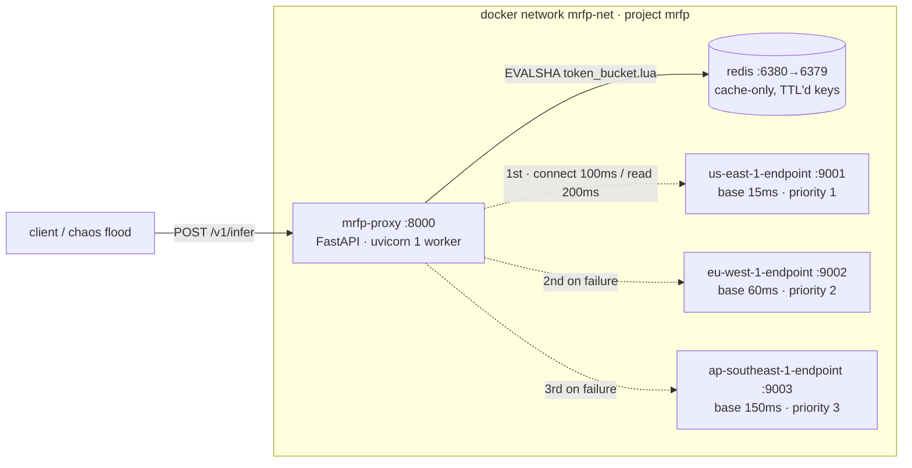

# Multi-Region Model Deployment & Failover Proxy

A FastAPI reverse proxy that fronts three containerised "cloud regions" serving model inference,
rate-limits callers with a Redis token bucket, and keeps serving traffic when a region dies mid-flood.

The mock inference isn't the interesting part. The failure surface is:

- `docker stop` does **not** cause a timeout. Docker's embedded resolver withdraws the container's
  DNS record, so the client gets a `ConnectError` — **4.8 ms p50** here,
  against a 200 ms read timeout that is never reached. Most implementations of this brief assume a
  timeout and never find out.
- `docker pause` **does** cause a timeout — the kernel still ACKs the SYN from the listen backlog, so
  the connection succeeds and then hangs. **202.6 ms p50**: the only way to
  prove the 200 ms read timeout is actually live.
- A warm keep-alive pool turns a killed upstream into a `RemoteProtocolError`, which is neither of
  the above.

Three failure modes, three different code paths, one `except` clause that has to handle all of them.

> **Two profiles.** `demo` (the default) is the graded brief, unchanged and still passing all 11
> chaos assertions. `prod` ([ADR-021](docs/DECISIONS.md#adr-021)) is the production configuration:
> breaker on, realistic timeouts, auth required, no pinned container names. `make prod-config`
> renders it. What production readiness does and does not mean here is stated plainly at the bottom
> of this file.
>
> **Status: complete and measured.** All four brief requirements are implemented, and every scenario
> in the matrix passes. The documentation was written before the code, deliberately
> ([ADR-001](docs/DECISIONS.md#adr-001-contract-first)). Every measurement in this repository was
> produced by a script and lives inside an `AUTOGEN` block — `make docs-check` fails the build if one
> is left unfilled. Full results: [docs/CHAOS-REPORT.md](docs/CHAOS-REPORT.md).

---

## The four requirements, and where to look

This project is built to a brief. Each requirement maps to a location frozen in
[docs/CONTRACT.md](docs/CONTRACT.md):

| # | Requirement | Lives in | Prove it with |
|---|---|---|---|
| 1 | Three containers named `us-east-1-endpoint`, `eu-west-1-endpoint`, `ap-southeast-1-endpoint`, plus Redis | `docker-compose.yml` (`container_name:` on each), `region/app/main.py` | `docker compose ps --format '{{.Name}}'` |
| 2 | A Redis token bucket, decremented per IP per request, returning 429 at zero | [`token_bucket.lua`](proxy/app/ratelimit/lua/token_bucket.lua) → [`limiter.py`](proxy/app/ratelimit/limiter.py) → [`context.py`](proxy/app/middleware/context.py) | a 30-request parallel burst → 21×`200`, 9×`429` |
| 3 | Prioritise `us-east-1`; `httpx` with a ~200 ms timeout; wrapped in `try`/`except` | [`proxy/app/router.py`](proxy/app/router.py) `ResilientRouter.route`, timeout built in [`region_client.py`](proxy/app/region_client.py) `_build` | `make chaos-pause-us-east` → transition p50 ≈ 200 ms |
| 4 | A script that runs `docker stop us-east-1-endpoint` during a flood; the `except` catches, logs, and routes to `eu-west-1` | [`chaos/run.py`](chaos/run.py), [`docker_ctl.py`](chaos/docker_ctl.py), caught in [`router.py`](proxy/app/router.py), logged as `upstream_failover` | `make chaos` → 11 assertions, exits non-zero on regression |

**On requirement 3 and 4 together:** a circuit breaker is the obvious improvement here, but it would
open `us-east-1` after ~5 failures, meaning the `except` block fires for 5 of ~3000 requests during
the flood and the graded behaviour becomes invisible. So `MRFP_MODE=literal` is the **default** — no
breaker, no health poller, every request walks the priority list and really does hit the `except`.
The breaker ships as an opt-in second mode, and `make chaos` runs both and reports the difference.
Assertion **A13** fails the run if `upstream_failover` log lines drop below 95 % of the requests that
failed over, so the requirement cannot silently rot.

---

## Architecture



Regions carry simulated base latency (15 / 60 / 150 ms) so the priority order means something
physically, and inference is deterministic across regions so a failover can be diffed without noise.

---

## Quickstart

**Step 0 works with Docker stopped.** That's intentional — you get a green result before you fight
any infrastructure.

```bash
make test-unit     # 58 tests, no Docker, no Redis, no sockets. Green in under a second.
```

Then:

```bash
make doctor        # preflight: daemon, port conflicts, disk, architecture, make version
make build         # first build is 3-6 minutes; it's separate from `up` on purpose
make up            # start 5 containers, wait for healthy
```

Check it routes to the primary:

```bash
curl -si localhost:8000/v1/infer \
  -H 'content-type: application/json' -d '{"prompt":"hello"}' \
  | grep -E '^(HTTP|X-Served-By-Region|X-Attempts)'
```

```
HTTP/1.1 200 OK
X-Served-By-Region: us-east-1
X-Attempts: 1
```

Kill the primary and watch it keep working:

```bash
docker stop us-east-1-endpoint
curl -si localhost:8000/v1/infer \
  -H 'content-type: application/json' -d '{"prompt":"hello"}' \
  | grep -E '^(HTTP|X-Served-By-Region|X-Failover-Path)'
```

```
HTTP/1.1 200 OK
X-Served-By-Region: eu-west-1
X-Failover-Path: us-east-1:connect_error(2.7ms),eu-west-1:ok(76.0ms)
```

_(a real response from this stack; your latencies will differ)_

Then run the real thing:

```bash
make chaos         # flood + docker stop + recovery, with assertions. Exits non-zero on regression.
```

---

## The demo, in five beats

If you're showing this to someone, this is the order that lands.

1. **`make chaos`** — a request flood is running, a region gets killed mid-flight, and a per-second
   timeline prints showing traffic move from `us-east-1` to `eu-west-1` in one second and back after
   recovery. Every assertion prints PASS/FAIL and the process exits non-zero if any failed.
2. **`docker compose logs --no-log-prefix proxy | jq -c 'select(.event=="upstream_failover")'`** —
   the `except` block, caught red-handed, with the exception class and the elapsed time.
   `error_class` is `ConnectError`, not a timeout.
3. **`make chaos-pause-us-east`** — same experiment with `docker pause` instead of `stop`. Now the
   transition p50 sits at ~200 ms because this one *is* a timeout. Two failure modes, visibly
   different latency signatures, one code path.
4. **The 429 burst** — 30 requests fired in parallel
   (`seq 1 30 | xargs -P 30 -I{} curl -s -o /dev/null -w '%{http_code}\n' localhost:8000/v1/infer
   -H 'content-type: application/json' -d '{"prompt":"x"}' | sort | uniq -c`): 21 succeed, 9 are
   rejected — capacity 20, plus one that refilled mid-burst. The burst has to land inside one refill interval — a slow sequential loop refills as it
   goes and hides the 429s. Then find the bucket with
   `redis-cli -p 6380 --scan --pattern 'rl:v1:*'` (the identity comes from `/debug/whoami`; on
   Docker Desktop it is usually the bridge gateway, not `127.0.0.1`) and `HGETALL` it to see
   *fractional* tokens — a small detail with a long explanation ([LEARNING.md](docs/LEARNING.md)).
5. **Stop all three regions** — clean `503` with `X-Failover-Path` showing all three attempts, and
   the proxy itself still answers `/healthz`. Degrading is not the same as crashing.

---

## Results

The same `except` clause, two ways of killing a region, 42× apart:

| | `docker stop` | `docker pause` |
|---|---|---|
| Exception | `connect_error` | `read_timeout` |
| Detection p50 | **4.8 ms** | **202.6 ms** |
| Read timeout exercised? | no — failed at DNS first | **yes** |
| Errors surfaced to clients | 0 of 801 | 0 of 801 |

Enabling the circuit breaker (`MRFP_MODE=resilient`) cuts p50 during an outage by ~3.6× — and cuts
the `upstream_failover` log lines by ~92%, because a skipped region is never attempted. That trade is
why `literal` is the default: better engineering, worse evidence for the thing the brief asks to see.

`make chaos` then `make report` regenerates [docs/CHAOS-REPORT.md](docs/CHAOS-REPORT.md) from the raw
artifacts. Only `AUTOGEN` regions are rewritten, so the prose survives and no number can be
hand-edited.

---

## Worth reading, in order

1. [docs/CONTRACT.md](docs/CONTRACT.md) — every name that crosses a boundary, frozen before the code
2. [proxy/app/router.py](proxy/app/router.py) — the failover loop
3. [proxy/app/failures.py](proxy/app/failures.py) — the exception taxonomy, and what each failure *means*
4. [proxy/app/ratelimit/lua/token_bucket.lua](proxy/app/ratelimit/lua/token_bucket.lua) — atomic refill/decide/debit/expire in one round trip
5. [chaos/run.py](chaos/run.py) — the harness and its assertions
6. [docs/ARCHITECTURE.md](docs/ARCHITECTURE.md) — the reasoning behind all of the above

---

## Configuration

Everything is `MRFP_`-prefixed. Full table in [docs/CONTRACT.md §2](docs/CONTRACT.md#2-configuration).
The ones you'd actually change:

| Variable | Default | Effect |
|---|---|---|
| `MRFP_MODE` | `literal` | `resilient` enables the circuit breaker |
| `MRFP_READ_TIMEOUT_MS` | `200` | The brief's number |
| `MRFP_TOTAL_BUDGET_MS` | `900` | Ceiling across all failover attempts |
| `MRFP_RL_CAPACITY` | `20` | Token bucket size |
| `MRFP_RL_REFILL_PER_SEC` | `20` | Refill rate |
| `MRFP_RL_FAIL_MODE` | `open` | Posture when Redis is unreachable |

---

## Troubleshooting

The three things a first-time runner actually hits:

| Symptom | Cause | Fix |
|---|---|---|
| `Cannot connect to the Docker daemon` | Docker Desktop isn't running | `open -a Docker`, wait ~30 s, `make doctor` |
| Everything 429s during a demo | All requests share one bucket — the proxy sees the Docker bridge gateway as the peer | `curl localhost:8000/debug/whoami` to see the resolved identity; use the chaos bypass token for load runs |
| Every request takes ~200 ms after a region dies | Expected in `literal` mode — that's the cost the breaker exists to remove | Re-run with `MRFP_MODE=resilient` to see the difference |

The full symptom → cause → check → fix matrix — the native-Redis port conflict, GNU Make 3.81,
graceful-shutdown, and architecture traps — is [docs/RUNBOOK.md §7](docs/RUNBOOK.md#7-troubleshooting).

---

## Documentation

| File | What it's for |
|---|---|
| [docs/CONTRACT.md](docs/CONTRACT.md) | Frozen names, schemas, ports, log vocabulary. The source of truth. |
| [docs/ARCHITECTURE.md](docs/ARCHITECTURE.md) | Request lifecycle, failure taxonomy, timeout arithmetic, why Lua. |
| [docs/RUNBOOK.md](docs/RUNBOOK.md) | Operating it: every command, every scenario, reading the logs. |
| [docs/DECISIONS.md](docs/DECISIONS.md) | ADRs — the contested calls and what was traded away. |
| [docs/CHAOS-REPORT.md](docs/CHAOS-REPORT.md) | Measured results. Generated, not written. |
| [docs/LEARNING.md](docs/LEARNING.md) | The concepts, explained: token buckets, timeouts, breakers, chaos — plus the glossary. |
| [CLAUDE.md](CLAUDE.md) | Context for AI agents working in this repo. |


---

## Is it production ready?

Two profiles, and the honest answer differs by which you mean.

**What the `prod` profile gives you.** Bounded memory enforced at boot; overload that sheds instead
of manufacturing a fake region outage; API-key auth with per-tenant quotas; a control plane that is
disabled unless configured; secrets absent from `docker inspect`; ~18× less middleware overhead
([ADR-022](docs/DECISIONS.md#adr-022), measured 473 µs → 25 µs per request); an availability SLI
that counts every response rather than only the ones the router saw; five alerts that page, each
with a runbook section whose existence `make docs-check` enforces; a rollable topology with no
pinned container names; and CI that runs the unit suite with no Docker, the Lua bucket against a
real Redis, a chaos scenario, and an SBOM-attested CVE-gated image build.

**What it does not give you.** No active health checking — detection stays passive by design, so the
first request into an outage still pays for it ([ADR-009](docs/DECISIONS.md#adr-009)). No
cross-replica coordination: breakers and the fallback bucket are per-process, so N replicas means N
independent detections and, during a Redis outage, N × the documented limit. Redis is a cache with
no persistence or HA. No streaming — the dominant real use case for a model API — because
buffer-for-replay and streaming are in direct tension and doing it properly needs a commit-latch
state machine that has not been built. No response deduplication: a `MAYBE_SENT` request without an
`Idempotency-Key` is refused rather than replayed. No TLS in the proxy; that terminates at the
ingress.

**And the regions are still mocks.** Every latency number here describes `blake2b` behind a
`sleep`. They are honest measurements of this system and meaningless as predictions for real
inference. The prod profile's 30 s read timeout is a guess until there is real traffic behind it.
