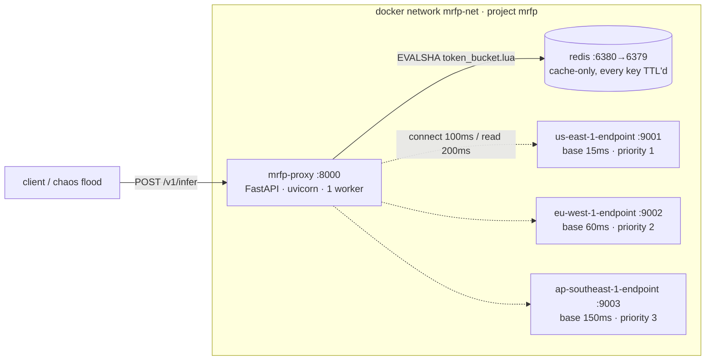
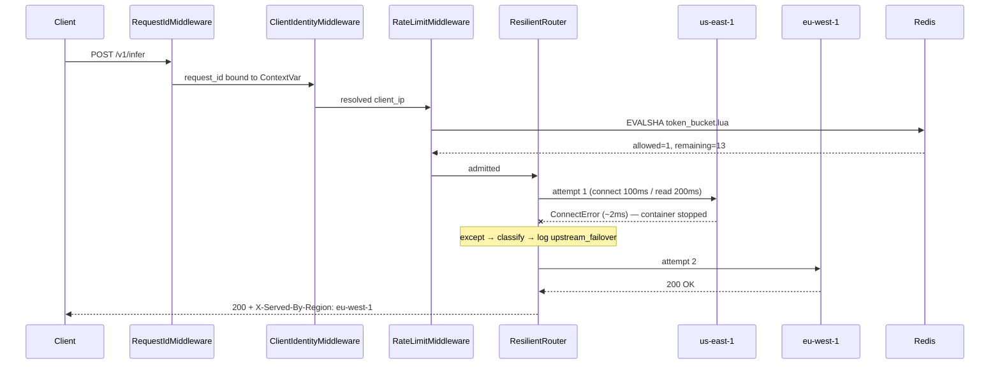
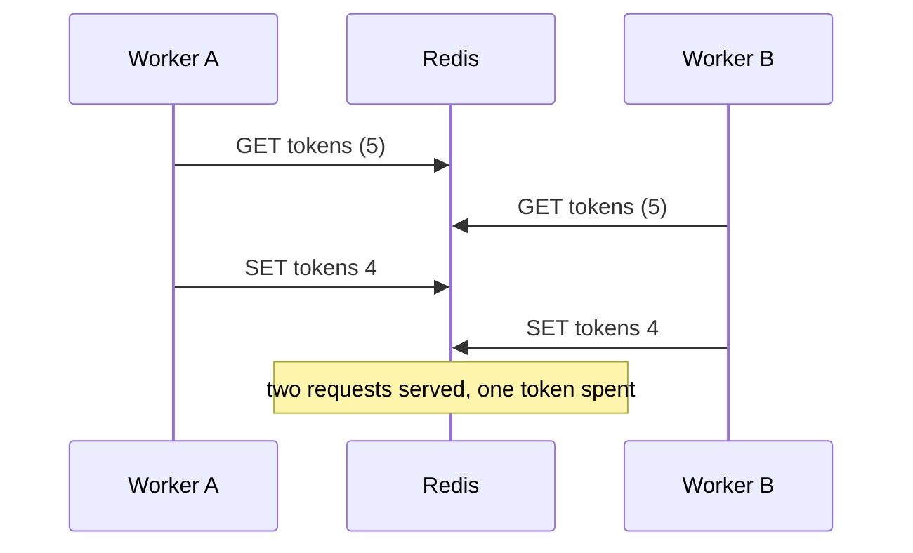
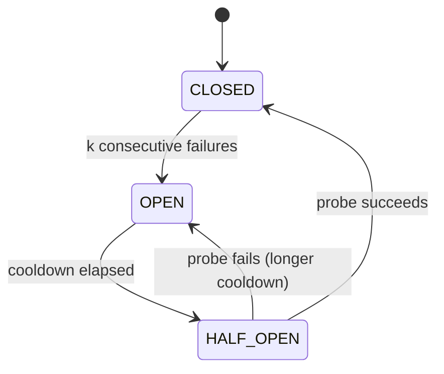

# ARCHITECTURE

Why this system is shaped the way it is. Names and schemas live in [CONTRACT.md](CONTRACT.md); the
trade-offs behind the contested calls live in [DECISIONS.md](DECISIONS.md). This file is the
reasoning in between.

---

## 1. Topology



Five containers. The three regions are **one image** (`mrfp/region:dev`) run three times with
different environment variables — a second image would be three places to fix a bug. They differ only
in `MRFP_REGION_ID`, `MRFP_REGION_ZONE`, and `MRFP_BASE_LATENCY_MS`.

The simulated latencies (15 / 60 / 150 ms) are not decoration. Without them, failover has no cost and
the circuit breaker has nothing to optimise; with them, "us-east is the primary" is a statement about
physics rather than a config line.

The proxy runs **one uvicorn worker**, pinned. `prometheus-client` without
`PROMETHEUS_MULTIPROC_DIR` reports only one worker's counters, so multiple workers would silently
under-report every metric in the chaos report. One worker also means the circuit breaker can live in
process memory instead of needing distributed state — see [ADR-008](DECISIONS.md#adr-008).

---

## 2. Request lifecycle



Starlette's `add_middleware` **prepends**, so the last registration is the outermost layer.
Registration order is therefore the reverse of execution order. Getting this backwards is not a
cosmetic bug: it puts the router outside the rate limiter, so 429s get attributed to `us-east-1` in
the metrics and `request.state.request_id` is unset when the 429 body is built.

| # | Stage | Responsibility |
|---|---|---|
| 1 | `RequestIdMiddleware` | Honour an inbound `X-Request-Id` or mint one; bind it to a `ContextVar` so every log line carries it. Honouring inbound matters: the chaos harness generates the id client-side and uses it to join its own CSV against the proxy's logs. |
| 2 | `ClientIdentityMiddleware` | Resolve the real client IP (§6). Uvicorn runs *without* `--proxy-headers` so there is exactly one owner of this logic. |
| 3 | `RateLimitMiddleware` | One `EVALSHA`. On deny, return 429 **without touching an upstream** — a rate-limited request must not cost a region anything. |
| 4 | Admission gate | `asyncio.Semaphore(128)`. If saturated, 503 immediately. Bodies are buffered, so unbounded concurrency is an unbounded memory commitment. |
| 5 | Body buffering | Read once, max 256 KiB. A streamed body cannot be replayed to a second region, and replay is the entire feature. |
| 6 | `ResilientRouter.route` | Walk the priority list under a total budget (§3). |
| 7 | Response assembly | Stamp `X-Served-By-Region`, `X-Failover-Path`, `X-Attempts` — on the 503 as well as on success. |

---

## 3. The failover loop

```
for each region in priority order:
    if no time left in the 900 ms budget     -> stop
    if breaker is open (resilient mode only) -> skip, no attempt made
    if the previous attempt put bytes on the wire and this request isn't replayable -> stop
    try:  send with a 200 ms read timeout
    on success -> return
    on failure -> classify, log, record, move to the next region
return 503 describing every attempt
```

Three details that are easy to get wrong:

**The asyncio ceiling is 15 % above the httpx timeout, not equal to it.** Both mechanisms are racing
to fire; if they're set to the same value, which one wins is a coin flip, and the recorded failure
code alternates between `read_timeout` and `attempt_deadline` run to run. Tests flake, and the chaos
report becomes non-reproducible. Setting the outer ceiling slightly higher makes httpx reliably win,
which is what we want — httpx knows *why* it failed. The ceiling then exists only for the case httpx
genuinely cannot catch (§4).

**4xx is not a failure.** A `400` means the region is alive and healthy and the *caller* sent
something bad. Retrying it against all three regions turns one client error into three units of work
and reports a phantom outage. Only 5xx and 429 from an upstream count as region failures.

**`CancelledError` is not caught.** It is a `BaseException`, and it means the client hung up. Catching
it would record a failure against a perfectly healthy region and, under a flood where clients time
out, could trip a breaker on a region that never did anything wrong.

### Timeout budget arithmetic

| | connect | read | worst case per attempt |
|---|---|---|---|
| attempt | 100 ms | 200 ms | 300 ms |

Three attempts is 900 ms worst case, which is exactly the total budget — so the budget binds at the
same moment the third attempt would exhaust. Beyond that, the router stops rather than starting a
fourth thing it can't finish.

The general rule this encodes: **a proxy's total timeout must be shorter than its caller's.** If the
client gives up at 1 s and we're still on attempt 3 at 1.1 s, that work is thrown away and every
region paid for it anyway.

---

## 4. Failure taxonomy

This table is the intellectual core of the project. Each row is a different physical thing happening
on the wire, and they are *not* interchangeable.

Latencies below marked **measured** come from this machine, via
`X-Failover-Path` on real requests. The rest are the configured timeout values.

| Injection | Exception | Class | Latency | Safe to replay? |
|---|---|---|---|---|
| `docker stop` | `ConnectError` — Docker's embedded resolver withdraws the A record, so DNS fails (`[Errno -2] Name or service not known`) | NOT_SENT | **2.5–9.3 ms, measured** | yes |
| `docker stop` with a warm pool | `RemoteProtocolError` — the server closed a pooled connection mid-flight | MAYBE_SENT | ~ms | only if idempotent |
| `docker kill` | `ReadError` / `RemoteProtocolError` — RST on pooled sockets | MAYBE_SENT | ~ms | only if idempotent |
| `docker pause` | `ReadTimeout` — the kernel still ACKs the SYN from the listen backlog, so connect *succeeds*, then nothing | MAYBE_SENT | **200 ms** | only if idempotent |
| chaos `blackhole` | `ReadTimeout` | MAYBE_SENT | **203–211 ms, measured** | only if idempotent |
| `docker network disconnect` | `ConnectError` — the endpoint's DNS record is withdrawn, same as `stop` | NOT_SENT | ~ms | yes |
| several regions stopped at once | `ConnectTimeout` — observed transiently while the resolver state churns; the record has not withdrawn yet, so the SYN goes to a dead address | NOT_SENT | **~101 ms, measured** | yes |
| pool saturated | `PoolTimeout` | NOT_SENT | 50 ms | yes |

**The headline: the brief's own chaos command cannot exercise the brief's own timeout.**
Measured on this machine through one unchanged code path:

```
docker stop  ->  us-east-1:connect_error(2.7ms)    DNS withdrawn; the read timeout is never reached
blackhole    ->  us-east-1:read_timeout(203.5ms)   connect succeeded, then silence
```

A ~75× difference in detection latency, and a different exception class, from the same `except`
clause. If you only ever inject `docker stop`, the 200 ms timeout the brief asks for is completely
unexercised and nothing tells you. That is why the scenario matrix carries both.

Two library facts that trip people up:

- `httpx.ConnectTimeout` is **not** a subclass of `httpx.ConnectError`, despite the names. The broad
  catch is `httpx.HTTPError`. A genuine unanswered-SYN `ConnectTimeout` never occurs naturally in
  this stack — Docker withdraws the DNS record along with the endpoint, so partitions here fail like
  `stop` — but production networks produce it constantly (firewalls dropping packets while DNS still
  resolves), and the classifier handles it.
- `classify()` **re-raises** anything outside httpx's exception tree. An unexpected exception is *our*
  bug, and silently counting it as an upstream failure would blame a healthy region for our defect.

### NOT_SENT vs MAYBE_SENT

A `ConnectError` means no bytes reached the server: replaying is free. A `ReadTimeout` means the
request may have been fully received and processed, and only the response was lost — replaying might
duplicate a side effect. Since our inference is deterministic and side-effect-free, replay is safe
here, and that is recorded as an explicit property rather than an accident. A real system would gate
this on an idempotency key.

### Why a warm pool changes the exception

The first request to a dead container fails at DNS. But if the pool already holds an established
keep-alive connection, there is no DNS lookup — the client writes into a socket whose peer has
vanished, and gets a protocol error instead. This is why the breaker purges a region's connection
pool when it opens, and why catching only `TimeoutException` would miss the most common real-world
case.

---

## 5. Rate limiting

### Why Lua

Read-modify-write on a shared counter is a lost update waiting to happen:



Under the chaos flood this will not stay theoretical — any concurrent burst can interleave the
GET/SET pair. `EVAL` runs the
whole read-refill-decide-debit sequence inside Redis's single-threaded execution, so it is atomic by
construction. One round trip, no lock, no watch/retry loop.

### The bucket

Refill is **lazy**: instead of a background job topping every bucket up, the elapsed time since the
last touch is converted into tokens on read. Idle buckets cost nothing, and there is no scheduler to
fail.

```
tokens = min(capacity, tokens + elapsed_seconds × refill_rate)
allow  = tokens >= cost
```

Four correctness details — persist the fraction, clamp at capacity, TTL ≥ full-refill time, refresh
the TTL on deny — are each a real bug if skipped; the mechanics and failure modes are worked through
in [LEARNING §1](LEARNING.md#1-token-buckets-and-why-not-a-fixed-window).

Returned values are integers only (Lua→RESP conversion truncates floats, so token counts come back
multiplied by 1000), and timestamps are written with `string.format('%.0f', …)` — the two Lua
formatting traps behind those rules are also unpacked in LEARNING §1.

Time comes from Redis's own `TIME` command rather than the client, so there is one clock regardless
of how many callers exist and no client-side skew.

### NOSCRIPT

`EVALSHA` fails after a Redis restart or `SCRIPT FLUSH`. The naive fix — catch and re-`EVAL` — sends
the full script body from every concurrent request at once. The naive fix to *that* — one lock around
the reload — serialises every request in flight behind a network round trip. The implementation uses
a generation counter so exactly one caller re-uploads and the rest re-check and proceed.

### When Redis is down

Redis failure fails **open**, behind the same breaker class as the regions, with an in-process
fallback bucket — because naive fail-open is still a latency outage: every request pays the socket
timeout before giving up. `X-RateLimit-Mode` reports which of `redis` / `local` / `open` actually
decided. The fail-open vs fail-closed argument is [ADR-013](DECISIONS.md#adr-013).

---

## 6. Client identity, and how it gets bypassed

Buckets are keyed on client IP, so "what is the client IP" is a security question.

`request.client.host` is wrong behind any proxy. Inside a container it is frequently the Docker
bridge gateway — the same value for every caller — so all clients would share one bucket and the demo
would look broken in a confusing way.

`X-Forwarded-For` is attacker-supplied. The rule is a **rightmost-untrusted walk**: only consult XFF
if the direct peer is a trusted proxy, then scan the chain right-to-left for the first untrusted
entry.

The trap is the fallback when *every* entry is trusted. Returning `chain[0]` — the leftmost value —
hands control to the attacker:

```
# attacker sends a different value each time
curl -H 'X-Forwarded-For: 1.2.3.4' …    -> bucket rl:v1:{ip:1.2.3.4}:burst    (fresh, full)
curl -H 'X-Forwarded-For: 1.2.3.5' …    -> bucket rl:v1:{ip:1.2.3.5}:burst    (fresh, full)
```

Every request mints a new full bucket and the limiter does nothing. The fallback is therefore **the
peer**, never `chain[0]`, and there is a test (`spoof_cannot_mint_fresh_buckets`) that fires 200
distinct XFF values and asserts they all land in one bucket.

The trusted set defaults to loopback only, deliberately not all of RFC1918 — Docker Desktop's bridge
gateway is an RFC1918 address, so the broad default would grant XFF authority to every container.

---

## 7. Circuit breaker



Why it's worth having: without one, a dead primary is a **permanent tax on every request**. In
`literal` mode, each request tries `us-east-1`, waits for it to fail, then moves on — so p50 rises by
the full failure latency for as long as the outage lasts. The breaker removes that tax after the
first few requests.

Why it's **off by default**: it also removes the brief's requirement from the demo. Once the breaker
opens, requests are *skipped* rather than *attempted*, so the `try`/`except` stops firing. Under a
flood, the graded behaviour would appear in ~5 of ~3000 requests. `MRFP_MODE=literal` is the default
so the requirement is genuinely exercised ([ADR-009](DECISIONS.md#adr-009)).

Implementation notes: `HALF_OPEN` admits exactly one probe (single-flight), or every request in
flight would stampede a recovering region. Opening the breaker also purges that region's connection
pool — stale keep-alive sockets to a restarted container are exactly what produce
`RemoteProtocolError`. The purge is scheduled via `asyncio.create_task` with the task held in a
module-level set; [LEARNING §5](LEARNING.md#5-circuit-breakers-and-the-arithmetic-that-justifies-them)
explains why anything less silently drops it.

An **active health poller** was considered and cut. It would mark a region down before any real
request failed, which is better engineering and worse for this brief — the `except` block would never
fire at all. [ADR-009](DECISIONS.md#adr-009) records the trade.

---

## 8. Observability

Logs are single-line JSON with a closed event vocabulary ([CONTRACT §8](CONTRACT.md#8-log-event-vocabulary)).
The same strings are metric label values and the terms used in these docs — one concept, one word, so
grepping the docs finds the log lines and the metrics too.

The `upstream_failover` line is the one the brief asks for, and it carries everything needed to
reconstruct the decision afterwards: `from_region`, `to_region`, `error_class`, `error`, `elapsed_ms`,
`request_id`.

Metrics at `/metrics`: `proxy_requests_total`, `proxy_failover_total{from_region,to_region,code}`,
`proxy_upstream_latency_seconds` (bucket edges straddle 0.2 so the timeout is visible in the
histogram), `proxy_circuit_state`, `rate_limit_rejected_total`, `rate_limit_mode_total`,
`rate_limit_noscript_recoveries_total`.

Prometheus and Grafana **containers** were cut — see [ADR-010](DECISIONS.md#adr-010). `/metrics`
stays, because the chaos assertions read it.

---

## 9. Measurement methodology

Three rules keep the harness honest: it is an **open-loop** pacer (`next_at += 1/rps`, issued on
schedule whether or not earlier requests returned); routing assertions are keyed on **send** time,
not receive time; and a run that achieves under 90 % of target throughput refuses to report at all,
with a 5 s client timeout — ~25× the proxy's — so a client-side abort can never be misread as a
proxy failure. Why each rule matters (coordinated omission, the send-time trap) is worked through in
[LEARNING §6](LEARNING.md#6-chaos-engineering-pick-the-fault-deliberately).

---

## 10. Known limitations

- **Single proxy instance.** The breaker is in-process; N workers would each need to learn about an
  outage independently. Fixing that means Redis-backed breaker state, which adds a distributed lock
  and makes Redis a dependency of the resilience path.
- **No hedging.** A slow-but-alive region is only detected by timing out. Sending a speculative
  second request after a delay would cut tail latency, at the cost of duplicate work and
  significantly more complex cancellation.
- **Rate limiting is per-instance-of-Redis, not per-region.** A degraded region doesn't cost more
  tokens. That was prototyped and cut — it let the limiter shed load during the failover experiment,
  contaminating the measurement.
- **HTTP/1.1 only, buffered bodies.** Streaming responses would break replay; HTTP/2 would change the
  connection-reuse behaviour that produces `RemoteProtocolError`.
- **`/healthz` on regions goes red during chaos modes.** That's honest — but it means
  `docker compose ps` shows a region unhealthy while the proxy is correctly routing around it. Keep
  it in mind during a demo.
